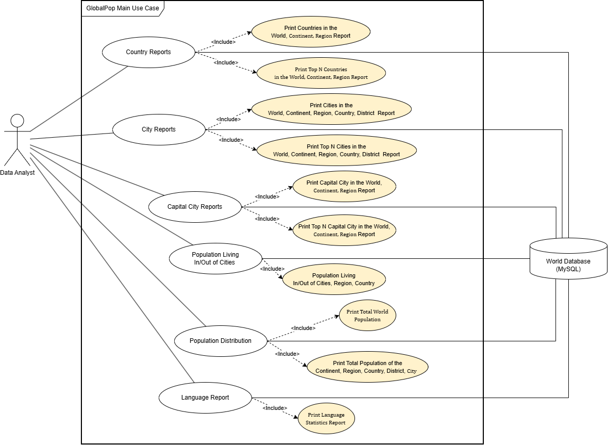

# GlobalPop Population Information System – Use Case Diagram Explanation

## 1. Introduction

The GlobalPop Population Information System is a Java-based application that allows a Data Analyst to generate different reports about countries, capital cities, cities, population distribution, and languages around the world. The system uses a MySQL World Database to retrieve the required information.

The main purpose of the system is to help the Data Analyst access and analyse population information in an organised way.

## 2. Actors and Database

### 2.1 Data Analyst

The Data Analyst is the main actor in the system. The actor interacts with GlobalPop to select and generate the required reports.

The Data Analyst can access the following main use cases:

- Country Reports
- Capital City Reports
- City Reports
- Population Distribution
- Population Living In/Out of Cities
- Language Report

Each use case provides different information to support population analysis.

### 2.2 World Database (MySQL)

The World Database is the external data source used by GlobalPop. It stores information about countries, cities, capital cities, populations, and languages.

When the Data Analyst requests a report, the system retrieves the relevant information from the database, processes the data, and displays the report.

## 3. Main Use Cases

### 3.1 Country Reports

The Country Reports use case allows the Data Analyst to generate reports about countries around the world.

It includes the following functions:

- **Print Countries in the World, Continent, Region Report:** Displays country information for the world or a selected continent or region.
- **Print Top N Countries in the World, Continent, Region Report:** Displays the top N countries according to the application's supported ranking criteria within the selected geographical scope.

The Top N report allows the Data Analyst to focus on a specified number of countries rather than viewing the complete list.

### 3.2 Capital City Reports

The Capital City Reports use case allows the Data Analyst to view information about capital cities.

It includes the following functions:

- **Print Capital City in the World, Continent, Region Report:** Displays capital city information based on the selected geographical scope.
- **Print Top N Capital City in the World, Continent, Region Report:** Displays the top N capital cities according to the application's supported ranking criteria.

These reports help the Data Analyst compare capital cities and examine their information at different geographical levels.

### 3.3 City Reports

The City Reports use case provides information about cities at different geographical levels.

It includes the following functions:

- **Print Cities in the World, Continent, Region, Country, District Report:** Displays city information for the selected geographical scope.
- **Print Top N Cities in the World, Continent, Region, Country, District Report:** Displays the top N cities according to the application's supported ranking criteria.

These reports help the Data Analyst examine city information and identify cities that meet the selected ranking requirements.

### 3.4 General Population Lookups

The Population Distribution use case allows the Data Analyst to examine population information at different geographical levels.

It includes the following functions:

- **Print Total World Population:** Displays the total population of the world.
- **Print Total Population of the Continent, Region, Country, District, City:** Displays population totals for the selected geographical level.

These functions help the Data Analyst understand how the population is distributed across the world and its geographical areas.

### 3.5 Population Living In/Out of Cities

The Population Living In/Out of Cities use case allows the Data Analyst to examine the population living inside and outside cities.

It includes the following function:

- **Population Living In/Out of Cities, Region, Country:** Provides information about the population living inside and outside cities, with the report organised according to the supported geographical scope.

This use case helps the Data Analyst understand the distribution of people between urban and non-urban areas.

### 3.6 Language Report

The Language Report use case allows the Data Analyst to access information about languages recorded in the World Database.

It includes the following function:

- **Print Language Statistics Report:** Displays language statistics to help the Data Analyst examine language information.

The report supports the analysis of language-related information stored in the database.

## 4. Use Case Relationships

### 4.1 Association Relationship

An association relationship connects an actor to a use case that the actor interacts with.

In the diagram, the Data Analyst is connected to the main reporting use cases. These connections show that the Data Analyst can request the different reports provided by GlobalPop.

### 4.2 Include Relationship

The `<<include>>` relationship connects a main use case to a supporting use case that forms part of its behaviour.

In the diagram, the include relationships connect the main reporting functions to more specific report functions. For example:

- Country Reports includes printing country information and generating Top N country reports.
- Capital City Reports includes printing capital city information and generating Top N capital city reports.
- City Reports includes printing city information and generating Top N city reports.
- Population Distribution includes printing total world population and population totals at different geographical levels.
- Population Living In/Out of Cities includes the more detailed population report.
- Language Report includes printing the language statistics report.

These relationships organise the reporting functions into main use cases and their supporting functions.

## 5. System Boundary

The rectangle labelled **GlobalPop Main Use Case** represents the system boundary. It identifies the functions provided by the GlobalPop application.

The Data Analyst is outside the system boundary because the actor represents a user who interacts with the application. The World Database (MySQL) is also an external data source rather than a reporting use case.

The use cases inside the boundary represent the application's main reporting functions and their supporting operations.

## 6. Overall Use Case Process

The general process of using GlobalPop is as follows:

1. The Data Analyst selects a required report.
2. The application identifies the type of information needed.
3. The application retrieves the relevant records from the World Database (MySQL).
4. The application processes the retrieved information according to the selected report.
5. The application generates and displays the requested report to the Data Analyst.

This process allows the Data Analyst to access country, city, capital city, population, and language information through a single application.

## 7. Conclusion

The GlobalPop Main Use Case Diagram describes how the Data Analyst interacts with the GlobalPop Population Information System to generate different reports. It identifies the main reporting functions, their supporting use cases, and the role of the World Database (MySQL) as the source of information.

The diagram provides an overview of the system's main functionality and shows how the reporting features are organised to support population analysis.
